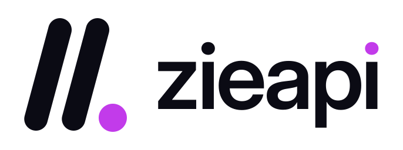

<p align="center">
  <picture>
    <source media="(prefers-color-scheme: dark)" srcset="brand/logo/zieapi-horizontal-white.svg">
    
  </picture>
</p>

# zieapi

**One API key for hundreds of public data sources, Indonesia first.**

zieapi is a complete, self-hostable public-data API platform with zero runtime dependencies (Node.js ≥ 20). It includes:

- **Website:** a landing page with the animated globe hero, a searchable catalog, a page per scraper with a "Try it" console and code samples, pricing, docs, the MCP page, a showcase, a status page, issue reporting and legal pages.
- **Accounts:** email/password sign-in plus GitHub, Google and Discord OAuth.
- **Dashboard:** overview, API keys (with IP allowlists), usage charts, request logs, bulk jobs, signed webhooks, billing with manual bank-transfer invoices, and settings.
- **Admin panel:** users and plans, invoice approval, scraper on/off switches, reports and showcase moderation.
- **API:** `GET|POST /v1/{category}:{scraper}/{endpoint}` with one envelope, plans and quotas, per-minute rate limits, caching, bulk jobs with idempotency, OpenAPI files and `llms.txt`.
- **MCP server** at `/mcp` with 8 tools for AI agents.
- **Catalog:** 296 scrapers and 1,271 endpoints across 24 categories, of which **92 scrapers / 333 endpoints are live**, all built on official public APIs, open data or publisher RSS feeds. The rest are listed as *planned*, or served by an optional upstream adapter.

The architecture and API contract come from an evidence-backed reverse-engineering study of zapi.ink, done with the [REA](https://github.com/morluto/rea) methodology. See [`docs/REA-REPORT.md`](docs/REA-REPORT.md) (Bahasa Indonesia) and [`docs/evidence/`](docs/evidence). No zapi code, scraper internals, branding or copy is reused. The catalog *structure* (sources, endpoint names, parameter schemas) was imported from their public OpenAPI index, with the circumvention category (Bypass Tools) removed.

## Run locally

```bash
git clone https://github.com/nafadza14/zieapi.git
cd zieapi
npm start              # → http://localhost:8787
```

1. Open http://localhost:8787 and click **Sign up**. Locally, the first account you create becomes **admin**.
2. Go to **Dashboard → API keys → Create key**.
3. Call an endpoint:

```bash
curl "http://localhost:8787/v1/indonesia:bmkg/gempa-terkini" -H "x-api-key: zie_xxx"
```

To run the tests: `npm test` (138 tests).

## Deploy to Vercel

1. Push this repo to GitHub and import it in Vercel (Framework preset: **Other**). `vercel.json` already sets the build (`npm test`), the output (`public`) and the rewrites to the `api/zieapi.js` function.
2. **Add storage:** Vercel → Storage → **Upstash for Redis** → connect it to the project. This sets `KV_REST_API_URL` and `KV_REST_API_TOKEN`. Without it, accounts and usage live in memory and reset on every cold start.
3. Set these environment variables:

   | Name | Value |
   |---|---|
   | `ZIE_PUBLIC_URL` | `https://your-project.vercel.app` (or your domain) |
   | `ZIE_ADMIN_EMAILS` | your email (becomes admin when you sign up) |
   | `ZIE_SESSION_SECRET` | any long random string |
   | `ZIE_BANK_INFO` | bank account text shown on invoices |
   | `GITHUB_CLIENT_ID/SECRET`, `GOOGLE_CLIENT_ID/SECRET`, `DISCORD_CLIENT_ID/SECRET` | optional OAuth; callback = `{ZIE_PUBLIC_URL}/auth/{provider}/callback` |

4. Deploy, open the site, and sign up with the admin email.

All options are listed in [`.env.example`](.env.example).

## API in one table

| | |
|---|---|
| Call | `GET` or `POST /v1/{category}:{scraper}/{endpoint}[/{path-params}]` |
| Auth | `x-api-key: zie_…` (or `Authorization: Bearer …`, or `api-key: …`) |
| Success | `{ "project", "data", "timestamp" }` |
| Errors | `{ "content", "message", "errors" }`; plan, bulk and quota errors use `{ "error": { "code", "message" } }` |
| Limits | `X-RateLimit-Remaining`, `X-RateLimit-Remaining-Month`, `Retry-After`. A 5xx is refunded. |
| Bulk | `POST …/{endpoint}/bulk` `{items:[…]}` + `Idempotency-Key`; `GET /v1/bulk/{id}` |
| Catalog | `/api/public/categories`, `/api/scrapers/list`, `/api/scrapers/{key}`, `…/schema`, `…/stats` |
| Machine docs | `/openapi.json`, `/category/{slug}/openapi.json`, `/llms.txt`, `/llms-full.txt` |
| MCP | `POST /mcp` with tools `search_scrapers`, `get_scraper_schema`, `list_categories`, `run_scraper`, `get_account`, `get_usage`, `bulk_submit`, `bulk_status` |

Plans, in Rupiah, are defined in `src/core/plans.js`:

| Plan | Price | Req/month | Req/min |
|---|---|---|---|
| Free | Rp0 | 600 | 100 |
| Pro | Rp49.000 | 25,000 | 2,000 |
| Ultra | Rp129.000 | 200,000 | 5,000 |
| Max | Rp399.000 | 1,000,000 | 15,000 |

## Billing flow (manual)

1. The user goes to Billing, picks a plan, and creates an invoice. The amount includes a unique 3-digit code.
2. They transfer the money and click **I've paid**, entering their reference.
3. An admin approves the invoice in Admin → Invoices. The plan becomes active for 30 days per month paid, and a `plan.changed` webhook fires.

## Adding scrapers

Copy `src/scrapers/_template.js` into `src/scrapers/live/` and register it in `src/scrapers/index.js`. A live module with the same `category:slug` as a catalog entry replaces its planned endpoints. Helpers in `src/scrapers/kit.js` (`getJson`, `feed`, `url`, `ScraperError`, `requireEnv`, …) keep handlers small. Use official APIs or open data only.

## Project layout

```
api/zieapi.js            Vercel function entry
public/assets/           site.css · site.js · dash.js · favicon
src/app.js               router: pages, auth, /api/me, /api/admin, /v1, /mcp
src/core/                catalog · executor · limits · bulk · webhooks · mcp · openapi · plans · validate
src/db/                  kv.js (Memory / Upstash) · repo.js (users, keys, usage, logs, invoices…)
src/auth/                passwords · sessions · API keys · OAuth
src/web/                 html layout + pages (home, catalog, pricing, docs, misc)
src/catalog/seed.js      catalog structure (generated by scripts/import-catalog.js)
src/scrapers/live/       live scraper modules (finance, indonesia, news, research-dev, media-apps, devtools)
brand/                   logo masters, icons, PNGs, presentation board, GUIDELINES.md
docs/                    REA report + evidence
test/                    node:test suites
```

## License

MIT © Zieads. Not affiliated with Zapi / Zeative Labs. You are responsible for complying with each data source's terms and with UU PDP.
